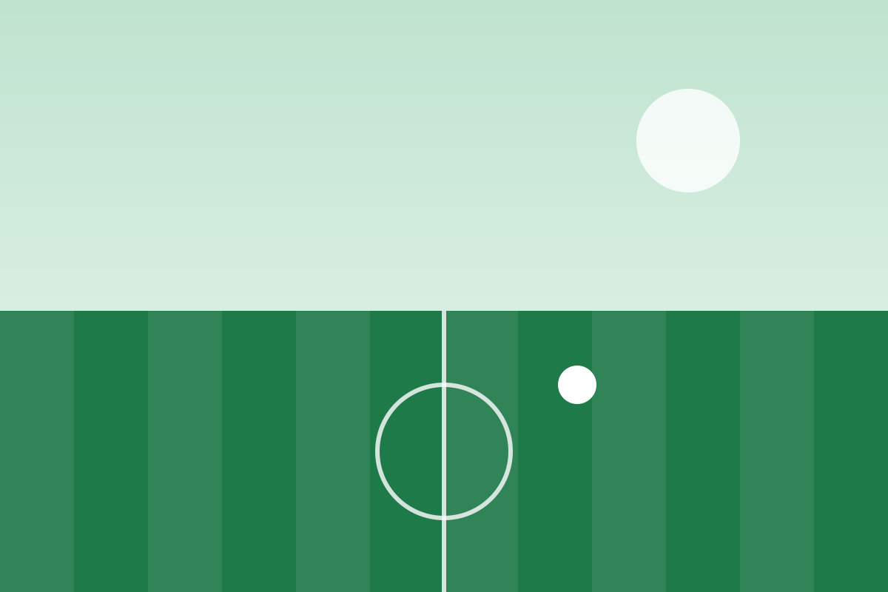

# Heimsieg im Derby: 3:1 vor ausverkauftem Haus

Die Fußballer drehten die Partie nach der Pause und feiern drei wichtige Punkte im Aufstiegsrennen.

Nach einem 0:1-Rückstand zur Halbzeit kam der Gastgeber stark aus der Kabine. Zwei Tore in zehn Minuten brachten die Wende, der Endstand fiel kurz vor Schluss.

Nächste Woche geht es auswärts weiter.
